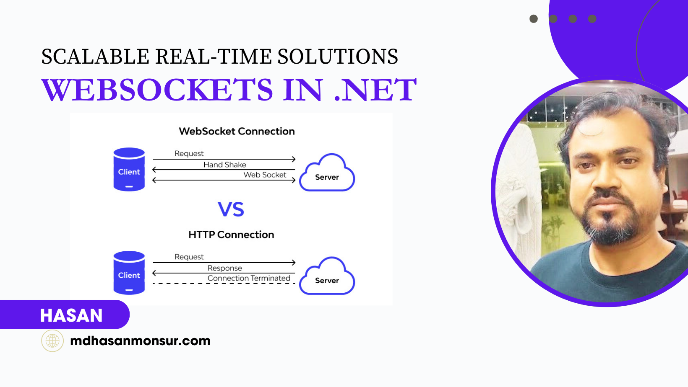
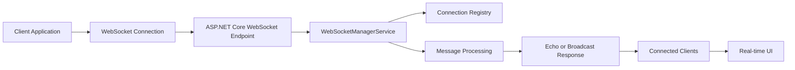
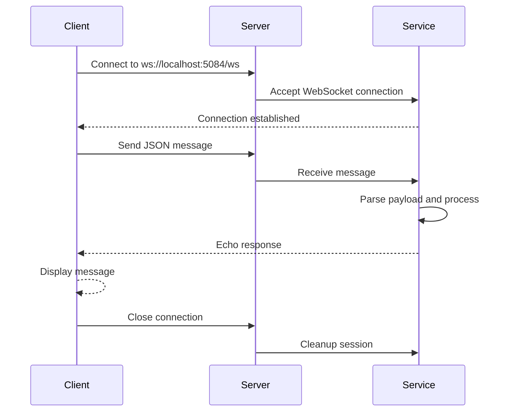

<meta name="title" content="WebSockets in .NET - Real-Time ASP.NET Core Example" />
<meta name="description" content="Learn how to build real-time WebSockets in .NET with ASP.NET Core, including a server and client sample for chat, notifications, and bidirectional communication." />
<meta name="keywords" content="WebSockets in .NET, ASP.NET Core WebSockets, real-time .NET, C# WebSocket server, WebSocket client .NET, signalr alternatives, real-time apps, .NET chat app, WebSocket tutorial" />
<meta name="author" content="Hasan Monsur" />

# WebSockets in .NET

A practical ASP.NET Core WebSocket sample that demonstrates how to build real-time, bidirectional communication in .NET. This project includes a lightweight WebSocket server and console client, making it an excellent starting point for chat apps, live dashboards, notifications, streaming events, and other real-time system patterns.

<div align="center">
  
</div>

## Why This Project Matters

WebSockets are essential when applications need fast, low-latency communication between a server and client. Unlike traditional HTTP polling, WebSockets keep a persistent connection open and allow both sides to send messages instantly.

This repository helps developers understand:

- how to set up a WebSocket endpoint in ASP.NET Core
- how to accept and manage client connections
- how to broadcast or echo messages between clients
- how to build a simple real-time message flow in .NET

## Project Overview

This repository includes a minimal but production-inspired implementation of:

- WebSocket server using ASP.NET Core `Map()` and `UseWebSockets()`
- client connection using `System.Net.WebSockets.ClientWebSocket`
- message serialization with JSON
- connection tracking and broadcasting support
- real-time echo and chat-style communication patterns

## Key Features

- ASP.NET Core WebSocket server setup
- Console-based WebSocket client
- JSON message model for communication
- Support for echoing messages to clients
- Connection management and lifecycle handling
- Clean sample structure for learning and extension

## Architecture and Data Flow



This simple architecture shows how a WebSocket connection remains open, allowing immediate message exchange without repeated HTTP requests.

## Sequence Diagram



## Benefits of WebSockets in .NET

### 1. Low-latency communication
WebSockets reduce delay by maintaining an open connection instead of repeatedly opening new HTTP requests.

### 2. Real-time updates
Perfect for live notifications, dashboards, stock feeds, collaboration tools, and chat systems.

### 3. Efficient for frequent interactions
They are more efficient than polling when clients need near-instant updates.

### 4. Better user experience
Users receive updates instantly without refreshing the page or waiting for periodic polling.

### 5. Simple for .NET developers
ASP.NET Core provides a straightforward model for building WebSockets without complicated infrastructure.

## Common Use Cases

This project is useful for:

- chat applications and messaging systems
- real-time monitoring dashboards
- live sports or trading updates
- collaborative tools and shared workspaces
- IoT device status monitoring
- system alerts and notification pipelines
- multiplayer gaming and event-driven apps

## Example Workflow

```csharp
app.UseWebSockets(new WebSocketOptions
{
    KeepAliveInterval = TimeSpan.FromMinutes(2)
});

app.Map("/ws", async context =>
{
    if (context.WebSockets.IsWebSocketRequest)
    {
        using var webSocket = await context.WebSockets.AcceptWebSocketAsync();
        var service = context.RequestServices.GetRequiredService<IWebSocketService>();
        await service.HandleConnectionAsync(webSocket);
    }
});
```

This allows the server to accept and manage a WebSocket connection on a dedicated endpoint and exchange messages continuously.

## Project Structure

```text
WebSockets-in-.NET/
├── WebSocketServer/
│   ├── Program.cs
│   ├── IWebSocketService.cs
│   ├── WebSocketManagerService.cs
│   ├── WebSocketMessage.cs
│   ├── appsettings.json
│   └── WebSocketServer.csproj
├── WebSocketClient/
│   ├── Program.cs
│   ├── WebSocketMessage.cs
│   ├── appsettings.json
│   └── WebSocketClient.csproj
├── WebSocketServer.sln
├── README.md
├── WebSocketsNET.png
└── .gitignore
```

## How to Run

### 1. Start the server
Open the solution and run the `WebSocketServer` project.

### 2. Start the client
Run the `WebSocketClient` project in a separate terminal or instance.

### 3. Send messages
Type a message in the console client and see the server echo it back.

```bash
dotnet restore
dotnet build
dotnet run --project WebSocketServer/WebSocketServer.csproj
dotnet run --project WebSocketClient/WebSocketClient.csproj
```

## Why Use WebSockets Instead of Polling?

WebSockets are ideal when your app needs continuous, real-time state updates. Polling repeatedly can create unnecessary traffic and delay. WebSockets keep a single connection open and reduce overhead for high-frequency communication.

## SEO Keywords

This repository is relevant for the following search terms:

- `WebSockets in .NET`
- `ASP.NET Core WebSockets`
- `C# WebSocket server`
- `real-time .NET application`
- `WebSocket client .NET`
- `WebSocket tutorial ASP.NET Core`
- `real-time messaging .NET`
- `C# chat application WebSocket`
- `WebSockets tutorial for developers`

## Related Article

For more context and a detailed explanation, visit:

- [Why Developers Choose WebSockets in .NET](https://medium.com/@hasanmcse/why-developers-choose-websockets-in-net-eb0390bb5ceb)

## Conclusion

This repository demonstrates the core ideas behind real-time communication in .NET using WebSockets. It is beginner-friendly, practical, and a strong foundation for building interactive features that require instant, low-latency updates.

---

<p align="center">
  <strong>Build real-time experiences with .NET WebSockets.</strong>
</p>
